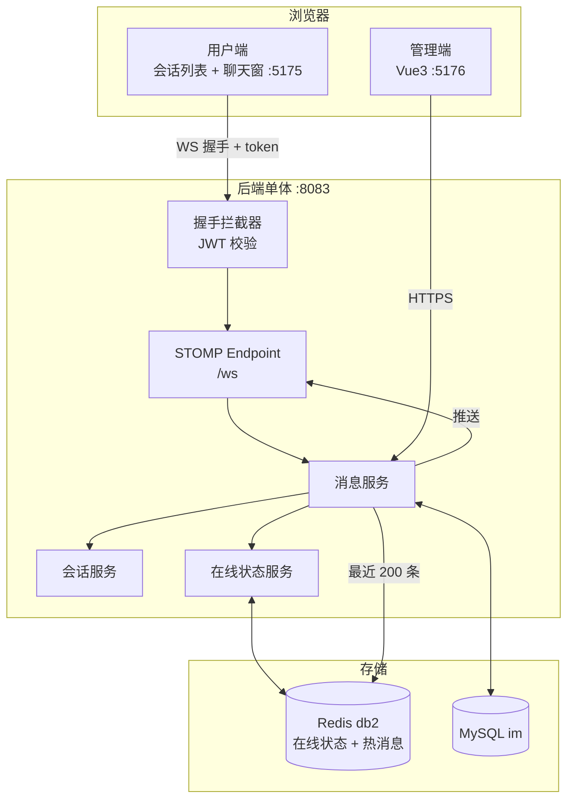
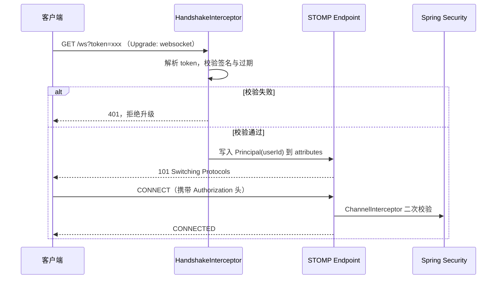

# 林间即时通讯系统 · 技术方案

> 版本：v1.0（2026-10-30）
> 定位：个人项目 · 面向 Java 后端岗位的深度作品
> 本文档只描述方案与约束，业务代码尚未开始编写。

---

## 1. 项目定位

本项目是一个**单体分模块**架构的即时通讯系统，核心目标是呈现「长连接怎么管、消息怎么保证可靠、多端怎么同步、群聊怎么扩散」四条主线，而不是复刻一个完整 IM 产品。

功能范围明确锁定为**标准集**：单聊、群聊、离线消息、已读回执、多端消息同步、在线状态。**不做**文件传输、语音视频、消息撤回、全文搜索，这些会把工作量引向对象存储与检索引擎，偏离后端主线。

## 2. 关键决策记录

| 编号 | 决策项 | 结论 | 主要理由 |
|---|---|---|---|
| M1 | 架构形态 | 单体 + 领域分包，不引入网关与注册中心 | 长连接场景下拆微服务反而削弱叙事说服力 |
| M2 | 仓库组织 | 一项目一仓库，公开仓库 | 与秒杀项目保持一致 |
| M3 | 前端组织 | 2 个独立工程，均以 `后台管理系统/frontend` 为基座派生 | 复用工程基建 |
| M4 | 用户端形态 | 共享基建，重做布局（会话列表 + 聊天窗双侧布局） | IM 需要有别于后台的交互形态 |
| M5 | 传输层 | Spring 原生 WebSocket + STOMP，不用 Netty | 与 Spring Security/JWT 天然集成；深挖点在消息可靠性而非协议栈 |
| M6 | 数据层 | 单 MySQL 实例、`im` 单库；Redis 单实例 db2 | 单机环境最优解 |
| M7 | 消息存储 | 冷热分离（Redis 存最近 200 条），不做分表 | 数据量不足时分表是纯负担 |
| M8 | 消息 ID | 雪花算法，同一会话内单调递增 | 保证单会话内消息可排序，不依赖数据库自增 |
| M9 | 群聊策略 | 写扩散（每人一份收件箱）仅用于离线未读，消息本体一份共享 | 平衡存储与读性能 |

## 3. 技术栈与版本

| 层 | 选型 | 版本 |
|---|---|---|
| JDK | Temurin OpenJDK | 21 |
| 框架 | Spring Boot | 3.2.5 |
| 长连接 | spring-boot-starter-websocket（STOMP） | 随 Boot |
| 持久层 | MyBatis-Plus | 3.5.6 |
| 安全 | Spring Security + JJWT | 0.12.5 |
| 数据库 | MySQL | 8.x，库名 `im` |
| 缓存 | Redis | 7.x（镜像 `redis:7-alpine`），`db2`，客户端为 Lettuce |
| 文档 | springdoc-openapi 2.3–2.5 + Knife4j 4.5.0（`jakarta` 坐标） | — |
| 压测 | Apache JMeter 5.6.x | — |
| 前端 | Vue 3 + Vite + Element Plus + Pinia + `@stomp/stompjs` | 3.4 / 5 |

> 订正（2026-10-31）：缓存原写「Redis 5.0.14」，与实机镜像 `redis:7-alpine` 不符，已改为版本区间并注明镜像来源；客户端明确为 `spring-boot-starter-data-redis` 默认携带的 Lettuce，不额外引入 Jedis。
>
> 订正（2026-10-31）：原表列有「限流 Sentinel 单机版 1.8.x」，本轮移除。理由是 W6 尚无消息发送入口，Sentinel 没有着力点；单机版 Sentinel 的 QPS 限流模型与长连接场景本来就不贴合（连接是长驻的，不是按次计费的）。**是否在 W7 随消息发送接口引入，留到 W7 决策时再定，此处不做预设。**

## 4. 总体架构



关键约束：**长连接与 HTTP 共用一个进程、一个端口**（WebSocket 复用 8083），不额外起推送服务。这是单体架构的必然选择，也是本项目与「微服务 IM」在面试时的分水岭——要能把「单机连接数上限」和「如何水平扩展」讲清楚，而不是假装已经扩展过。

> 端口说明：初版方案原定 8082，后因 `后台管理系统` 项目已占用 8082（见其 `application.yml`），本项目改为 8083，避免本机并行开发时端口冲突。
>
> 中间件端口（2026-10-31 补充）：MySQL 映射到宿主 **3307**、Redis 映射到宿主 **6380**，二者都不采用默认的 3306 / 6379。原因是本机同时存在秒杀系统，两套项目若共用默认端口，任何一方启动都会挤掉另一方；错开端口后两个项目可以并行运行、互不干扰。容器内仍是标准的 3306 / 6379，配置只需在连接串里改端口。

## 5. 后端模块划分

```
backend/
├── pom.xml                父 POM
├── im-common/             统一响应、异常、雪花 ID、常量
├── im-security/           JWT 签发校验、握手鉴权拦截器
├── im-chat/               会话、消息、群组、已读位点、Redis 操作
└── im-web/                启动类、STOMP 配置、Controller、WebSocket 端点
```

分层规则：`im-chat` 不依赖 `im-web`；`im-web` 只做协议适配（STOMP 目的地映射到服务方法），不允许写业务判断。

## 6. 连接层设计

### 6.1 握手与鉴权



握手期与 CONNECT 期**都要校验**：只在握手期校验会被绕过（STOMP 客户端可以不带 token 直接发 CONNECT）。

### 6.2 心跳与重连

- 服务端 `setHeartbeatValue(new long[]{10000, 10000})`，10 秒双向心跳。
- 客户端断线后按 1s / 2s / 4s / 8s / 最大 30s 指数退避重连。
- 重连成功后客户端调用 `GET /api/session/sync?lastMsgId=` 拉齐断线期间的消息，**不依赖服务端补推**。这是可靠性的关键取舍：补推需要服务端缓存未确认消息，成本远高于客户端拉取。

### 6.3 在线状态与多端

Redis db2 结构：

| 键 | 类型 | 说明 |
|---|---|---|
| `im:online:{userId}` | Set | 该用户全部在线 sessionId，支持多端同时在线 |
| `im:session:{sessionId}` | Hash | sessionId → userId + 设备类型 + 连接时间 |
| `im:route:{userId}` | String | 单端登录模式下记录当前有效 sessionId |

多端策略：默认允许多端同时在线；推送时向 `im:online:{userId}` 中所有 session 广播。若产品需要「单端登录」，则新连接建立时向旧 session 发 `DISCONNECT` 帧并踢下线。

## 7. 消息模型

### 7.1 表结构

| 表名 | 用途 | 关键字段与约束 |
|---|---|---|
| `im_session` | 会话（单聊/群聊统一抽象） | `session_type`(1 单聊/2 群聊)、`biz_key`（单聊为 `min:max` 用户 ID 拼接，唯一索引；群聊为 NULL）、`last_msg_seq` / `last_msg_at` / `last_msg_preview` 三个冗余字段 |
| `im_session_member` | 会话成员（W7 新增） | 联合主键 `(session_id, user_id)`，索引 `(user_id, session_id)`。会话列表与成员鉴权共用这一个索引 |
| `im_message` | 消息本体，全局一份 | 主键 `id`（雪花）、`session_id`、`seq`（会话内序号）、`sender_id`、`content`、`client_msg_id`；唯一索引 `(session_id, seq)` 与 `(sender_id, client_msg_id)` |
| `im_group` | 群信息（W8） | `owner_id`、`member_count` |
| `im_group_member` | 群成员（W8） | 唯一索引 `(group_id, user_id)` |
| `im_read_cursor` | 已读位点 | 联合主键 `(session_id, user_id)`，字段 `last_read_seq`。**W7 刻意没有 `device_type`**，理由见第 20 章 |
| `im_inbox` | 未读集合 | 唯一索引 `(user_id, session_id, seq)`，**只保留未读行，标记已读即 DELETE**。语义从「离线投递队列」改为「未读集合」，理由见第 20 章 |

### 7.2 消息序号策略

`im_message.id` 用雪花算法保证全局唯一；`im_message.seq` 是**会话内单调递增序号**，由 Redis `INCR im:seq:{sessionId}` 生成。

选择理由：全局 ID 无法直接用于「拉取某会话 seq > N 的消息」；会话内 seq 让增量同步变成一次范围查询，也比按时间戳分页可靠（同一毫秒的多条消息时间戳会重复）。

**seq 允许出现空洞（W7 明确取舍）。** `INCR` 必须先于 `INSERT` 执行（`INSERT` 要写 seq），所以「拿到号之后插入失败」或「拿到号之后进程被杀」都会消耗掉一个号，库里留下 `1,2,4,5` 这样的序列。所有读取路径都用 `seq > N` 的范围查询，不假设连续，因此空洞不影响正确性。反过来，为消除空洞而引入「反向 DECR」是错的——并发下会把别人的号也拽回去。

### 7.3 冷热分离（W8 决定不做）

初版方案写的是「热数据 `LPUSH` 到 `im:hot:{sessionId}` 并 `LTRIM 0 199`，冷数据留在 MySQL」。**W8 复核后放弃这个方案**，理由与证据见 `docs/性能验证.md`：

- 单机 MySQL 上，`uk_session_seq (session_id, seq)` 让「取会话最新 31 条」变成一次反向索引扫描 + `LIMIT` 提前终止。实测在 20 万条消息的会话上，取最近 31 条耗时 **0.29 ms**，增量补拉 0.14 ms，向历史深处翻一页 0.24 ms——缓存能省下的那点时间，不足以抵消它引入的一致性问题。
- 缓存与 `seq` 空洞叠加，是这套系统里最容易产生「乱序 / 重复」组合的地方。为一次毫秒级查询引入这个风险面，投入产出比不成立。
- 真正做过优化的是**调用次数**而不是数据位置：群聊从「200 次推送 + 200 次 Redis 在线判断」改成「1 次广播 + 1 条批量 INSERT」，这才是这个量级下的实际瓶颈。

**什么时候应该重新考虑**：单会话消息量进入千万级、或读 QPS 超过单库承受范围、或 `im_message` 单表超过单机磁盘容量（届时先分区/归档，再谈缓存）。

## 8. 群聊扩散策略

| 方案 | 存储成本 | 读成本 | 本项目采用 |
|---|---|---|---|
| 写扩散：每人一份消息副本 | 高（成员数 × 消息数） | 低 | 仅用于 `im_inbox` 未读引用 |
| 读扩散：消息一份，读时按成员关系过滤 | 低 | 高（需 join 成员表） | 消息本体采用此方案 |

消息本体只写一条 `im_message`。**推送分两条路（W8 定案）**：

- **单聊**：逐个 `convertAndSendToUser` 到 `/user/queue/message`。收件人由 Principal 决定，结构上不存在偷听。
- **群聊**：向 `/topic/session.{sessionId}` 广播一次。200 人群若逐个推，是 200 次序列化 + 200 次 Redis 在线判断；广播只发一次，在线判断这一步完全消失（广播天然只到「连着且订阅了」的人）。

广播的代价是 SimpleBroker 对 `/topic` 订阅不做 ACL，必须自带成员校验：`GroupTopicAuthInterceptor` 在 SUBSCRIBE 帧上解析目的地、查成员表，不是成员就丢弃这一帧（返回 `null` 而不是抛异常，避免一次越权订阅掐断整条连接）。

**未读引用**：所有成员（含在线）都写一行 `im_inbox`，用一条 `INSERT IGNORE ... VALUES (...),(...)` 批量写入。发送者不写——自己的消息不该给自己亮红点。

**发布订阅与成员变更的一致性**：订阅校验是「订阅那一刻」的一次性判断。成员被移出群后，已登记的订阅不会自动失效。W8 没有踢人功能，因此这个窗口当前不可达；做踢人时必须先解决它（订阅关系登记 + 主动断订阅，或推送时按人校验）。

## 9. 已读回执与多端同步

- 客户端滚到会话底部时上报 `last_read_seq`，服务端 upsert `im_read_cursor`。
- **未读游标的维度是「用户」，不是「设备」（W8 复核确认）**。加设备维度会直接产生「手机已读、电脑仍亮红点」这种反直觉状态；而且 W6 的 CONNECT 帧里没有可信的设备标识来源，只能让客户端自报，等于造一个可以随便填的维度。
- **未读数 = `COUNT(im_inbox)`（W7 订正）**。初版方案写的是「会话最大 `seq` − 当前设备 `last_read_seq`」，那个公式有两个问题：seq 空洞会让它多算未读；「设备」这个维度在 W7 没有可靠来源。改成对未读集合计数后，一次走唯一索引前缀的查询就是答案，也不受空洞影响。
- **多端同步（W8 落地）**：一端上报已读后，服务端把 `ReadResult` 推到该用户的 `/user/queue/read`，其他端据此清红点。上报的那台设备也会收到，客户端按 `(sessionId, lastReadSeq)` 幂等处理。
- **发送者自己也收推送（W8 改动）**：这样发送者的其他端能立刻看到自己发的消息，且 `seq` 只有一个事实来源（服务端）。客户端用 `MessageView.clientMsgId` 把「本地乐观插入」和「服务端回推」认成同一条，再用 ack 里的 `seq` 覆盖本地临时值。
- 已读回执的群聊版本只记录「读到哪」，不做「谁读了」的逐人列表——逐人列表是 O(n²) 存储，标准集不承担。

## 10. STOMP 目的地约定

| 目的地 | 方向 | 用途 |
|---|---|---|
| `/app/ping` | 客户端 → 服务端 | 连通性探针（W6 新增，见第 19 章） |
| `/app/chat.send` | 客户端 → 服务端 | 发送消息 |
| `/user/queue/message` | 服务端 → 客户端 | **单聊**新消息，按 Principal 私有投递 |
| `/topic/session.{sessionId}` | 服务端 → 客户端 | **群聊**新消息，广播一次；订阅需通过成员校验（W8 恢复此目的地） |
| `/user/queue/pong` | 服务端 → 客户端 | ping 回显（W6 新增，按会话私有投递） |
| `/user/queue/read` | 服务端 → 客户端 | 已读事件，推给本人所有连接用于多端清红点（W8） |
| `/user/queue/ack` | 服务端 → 客户端 | 单条消息落库确认 |

> **W7 订正**：初版方案的单聊目的地是 `/topic/session.{sessionId}`。实施时放弃了，原因是 SimpleBroker 对 `/topic` 的订阅**不做任何 ACL**——任何已登录用户只要拿到一个 sessionId 就能订阅别人的私聊。单聊改走 user destination 后，「谁能收到」由 Principal 决定，结构上不存在漏判。
>
> **W8 说明**：群聊必须回到 `/topic`（逐个推 200 人是 200 次序列化），但这次带了配套的 SUBSCRIBE 成员校验，见 `GroupTopicAuthInterceptor`。单聊目的地不变——已验证的路径不因为「统一」而重写。
>
> **W7 订正**：`/app/chat.read` 已从本表移除，已读上报改走 `POST /api/sessions/{id}/read`。判断依据是「丢了会怎样」：已读上报在 STOMP 上是 fire-and-forget，SimpleBroker 没有投递回执，丢了不会有任何信号，用户表现为红点不消；REST 至少有状态码可重试。

消息可靠性闭环：客户端发送后进入本地「发送中」队列，收到 `/user/queue/ack` 才标为成功；10 秒未收到则重发，重发携带同一个 `clientMsgId`，服务端据此去重。

## 11. 接口约定

复用秒杀项目的统一响应体 `{code, message, data, traceId}`。REST 接口只承担三类职责：登录、历史消息拉取、会话列表；实时交互全部走 STOMP。

| 错误码 | 含义 |
|---|---|
| 0 | 成功 |
| 4101 | 不在该会话中 |
| 4102 | 消息内容非法（超长/空白） |
| 4103 | 会话不存在 |
| 4104 | 重复消息（clientMsgId 冲突，返回成功即可） |
| 4010 | 未登录 |

## 12. 前端工程

| 工程 | 基座 | 页面范围 |
|---|---|---|
| `frontend-user` | 派生自后台管理系统 frontend，替换为双侧布局 | 登录、会话列表、聊天窗口、新建群聊、联系人；含 STOMP 客户端封装（心跳/重连/发送队列） |
| `frontend-admin` | 沿用基座布局 | 用户管理、群组管理、消息审计、在线连接数看板 |

STOMP 客户端必须封装为独立模块（`useStomp`），包含连接状态机、发送重试队列、断线重连后的 seq 补齐逻辑；不允许在组件里直接 new 客户端。

## 13. 工程化

- `docker-compose.yml` 编排：`mysql` / `redis` / `im-web` / `nginx`。
- 本项目的 RabbitMQ 暂不使用（单机 IM 无跨节点推送需求）；若后续做多节点，再用它做节点间广播——这一点要在文档里写明，避免「装了不用」被追问。
- GitHub Actions 同秒杀项目：`mvn verify` + `npm run build` + `docker build`。

## 14. 压测方案

| 项 | 内容 |
|---|---|
| 工具 | JMeter 5.6.x + WebSocket Sampler 插件 |
| 场景一 | 500 并发连接建立，观测握手成功率与建连耗时 |
| 场景二 | 500 连接 × 每分钟 20 条消息，持续 5 分钟，观测端到端延迟 |
| 场景三 | 单群 200 人同时在线，一条群消息的扩散耗时 |
| 观测指标 | 连接数、握手 P99、消息端到端 P99、消息丢失数、服务端内存与 GC |

**目标值（未实测，不得写入简历）**：握手成功率 100%、消息零丢失、端到端 P99 < 200ms、单机稳定连接数 2000 以上。

### 14.1 W8 已完成的单机数据层实测

不等 W9 的端到端压测，先做了一件更基础也更容易被追问的事：**证明「不引入 Redis 缓存」这个决定是站得住的**。方法是在独立库 `im_perf` 里造 30 万条消息（1 个 20 万条的会话 + 500 个 200 条的会话），对四条关键查询跑 `EXPLAIN ANALYZE`。

| 查询 | 数据量 | 实测耗时 |
|---|---|---|
| 取会话最新 31 条 | 20 万条消息 | 0.29 ms |
| `seq > N` 增量补拉 | 同上 | 0.14 ms |
| `seq < N` 历史深翻 | 同上 | 0.24 ms |
| 未读数 `COUNT(im_inbox)` | 5000 行未读 | 0.93 ms |
| 已读删除 4000 行未读 | 5000 行未读 | 23.8 ms |

完整执行计划原文、发现的问题（会话列表深翻页会退化成全表扫描 + 排序）与复现步骤见 **`docs/性能验证.md`**。

这些数字只覆盖数据层，不是端到端延迟——端到端 P99 仍要等 W9 的 JMeter 场景，没测过的数字不写。

## 15. 里程碑（W6–W9，接续秒杀项目）

| 周次 | 内容 | 产出物 |
|---|---|---|
| W6 | 骨架、STOMP 握手鉴权、心跳与重连客户端封装 | 双向连通的最小闭环 |
| W7 | 单聊、会话表、离线收件箱、在线状态 | 可聊天的单聊 — **已完成 2026-10-31，见第 20 章** |
| W8 | 群聊、已读回执、多端同步、冷热分离 | 完整标准集 — **已完成 2026-10-31，见第 21 章**（冷热分离经实测后主动放弃，见 7.3） |
| W9 | 两个前端、压测、CI、文档 | 交付包 + 压测报告 — **已完成 2026-10-31，见第 22 章**（HTML 报告不入库，见 22.4） |

## 16. 验收清单

1. `mvn verify` 通过；消息投递、幂等、未读数计算有单测；STOMP 端点有集成测试（`WebSocketStompClient`）。
2. `docker compose up` 一条命令拉起全栈。
3. 客户端断网 30 秒后重连，能补齐断线期间全部消息且不重复。
4. 同一账号两端在线，A 端已读后 B 端红点消失。
5. 仓库含 `技术方案.md`、`本地运行说明.md`、`面试准备.md`、`docs/W9压测报告.md`。

## 17. 风险与已知限制

| 风险 | 说明 | 应对 |
|---|---|---|
| 单机连接数上限 | 单进程受文件句柄与内存限制 | 文档写清理论上限与调优参数（`ulimit`、Tomcat 线程模型），不夸大 |
| 消息不丢的边界 | 未做端到端确认机制（无服务端缓存补推） | 明确说明「靠客户端拉取兜底」，这是取舍不是缺陷 |
| 群聊规模 | 200 人以上扩散耗时会明显上升 | 压测暴露该拐点并写入报告，这本身就是加分项 |
| 前端复杂度 | 聊天窗的滚动、已读、重连状态一起处理容易失控 | STOMP 逻辑全部收敛到 `useStomp`，组件只消费状态 |

## 18. 变更记录

| 版本 | 日期 | 变更 |
|---|---|---|
| v1.0 | 2026-10-30 | 初版，沉淀 M1–M9 决策 |
| v1.1 | 2026-10-31 | W6 实施后订正：Redis 版本、移除 Sentinel、补中间件端口、新增第 19 章实现差异记录 |
| v1.2 | 2026-10-31 | W7 实施后订正：消息推送到 `/user/queue/message`（弃用 `/topic`）、已读改走 REST、`im_inbox` 语义改为未读集合、未读数改用 `COUNT`、新增 `im_session_member`、新增第 20 章 |
| v1.3 | 2026-10-31 | W8 实施后订正：群聊恢复 `/topic/session.{id}` 并配套订阅鉴权、新增 `/user/queue/read`、多端改为发送者也回推、冷热分离经实测后放弃（7.3）、新增第 21 章与 `docs/性能验证.md` |
| v1.4 | 2026-10-31 | W9 实施后订正：`im_user` 增加 `role`、新增 `/api/admin/**` 与双链路禁用闸（REST 过滤链 + STOMP 帧拦截）、补 JMeter 压测基线与 `docs/W9压测报告.md`、客户端改订阅「我所在的全部群」、新增第 22 章 |

---

## 20. W7 实现差异记录

### 20.1 方案中新增的实现

| 项 | 方案原文 | 实际实现 | 原因 |
|---|---|---|---|
| 会话成员表 | 未涉及 | `im_session_member`，联合主键 `(session_id, user_id)` | `biz_key` 是 `min:max` 拼接串，无法用索引回答「包含我的会话有哪些」——而这是会话列表唯一的入口查询 |
| 联系人搜索 | 未涉及 | `GET /api/users/search?q=` | 没有它，客户端拿到一个空会话列表就无法发起第一个会话：用户不可能凭空知道对方的 userId |
| 会话摘要冗余 | 未涉及 | `last_msg_seq` / `last_msg_at` / `last_msg_preview` 三个字段 | 会话列表必须按「最近有消息」排序，靠子查询取最后一条会让 `ORDER BY` 无法走索引 |
| 幂等键 | 第 10 章提到「服务端据此去重」 | `(sender_id, client_msg_id)` 唯一索引 + 重复时回放原消息 | 只回错误码而不给 seq，客户端无法把本地「发送中」的消息替换成真实消息，下次拉取会重复显示 |
| REST 认证过滤器 | W6 遗漏 | `JwtAuthenticationFilter`（`OncePerRequestFilter`） | 见 20.3 第 1 条 |

### 20.2 与方案做法不同的地方

**1. 消息推送从 `/topic/session.{id}` 改为 `/user/queue/message`。**
SimpleBroker 对 `/topic` 的订阅不做任何 ACL，而 W6 的 `StompAuthChannelInterceptor` 只处理 CONNECT、完全不看 SUBSCRIBE。这意味着按方案原文实现，任何已登录用户只要拿到一个 sessionId 就能订阅别人的私聊。改用 user destination 后，收件人由 Principal 决定，结构上不存在漏判；额外收益是同一用户多端在线时自动各收一份。

**2. 已读上报从 `/app/chat.read` 改为 REST。**
判断依据是「这个操作丢了会怎样」。发消息丢了，客户端能靠 ack 超时发现并重发；已读上报在 STOMP 上是 fire-and-forget，SimpleBroker 没有投递回执，丢了没有任何信号，用户表现为红点不消。REST 至少有状态码可重试。

**3. `im_inbox` 从「离线投递队列」改为「未读集合」，且在线用户也写入。**
方案原文是「对离线成员，仅向 `im_inbox` 插入一条轻量记录」。这个策略有一个明确的功能缺陷：用户在线但没打开该会话时，消息只是「推到了连接上」，并不等于「人看过了」。若在线不写收件箱，未读数永远是 0，红点不会亮——而红点正是 IM 最核心的交互信号。
代价是每条消息多一次 INSERT、已读时多一次 DELETE。在单机 MySQL 上这个代价远小于「未读数不准」带来的功能错误。

**4. 未读数改用 `COUNT(im_inbox)`。**
原方案是「最大 seq − 已读 seq」。该公式在 seq 有空洞时会多算未读（见 7.2），而「设备」这个维度在 W7 没有可靠来源。改成对未读集合计数后，一次走唯一索引前缀的查询就是答案。

**5. `im_read_cursor` 只到用户维度，没有 `device_type`。**
W6 的 STOMP CONNECT 帧里没有任何可靠的设备标识来源，让客户端自报一个 `deviceType` 存进库，得到的只是一个不可信维度——它既不能用于多端同步判断，还会让「未读到底算谁的」变复杂。W8 做多端时再扩字段，届时多端语义要一起重新定义。

### 20.3 实施中发现的坑（已修复，记录备查）

**1. W6 的安全配置有 `authenticated()` 却没有认证过滤器。**
`SecurityConfig` 从 W6 起就写着 `anyRequest().authenticated()`，但整条过滤链里没有任何解析 JWT 的组件。W6 之所以没暴露，是因为当时唯一的业务接口是 `/api/auth/**`（permitAll），所有真实请求都被放行了。W7 一加 `/api/sessions`，这个缺口直接表现为「登录成功也一律 401」。补法是加 `JwtAuthenticationFilter` 并挂在 `UsernamePasswordAuthenticationFilter` 之前。

**2. Maven 资源目录少算一级。**
`im-web` 位于 `backend/im-web`，而 `sql/` 在项目根，路径应是 `../../sql` 而不是 `../sql`。写错时的现象很具体：`No schema scripts found at location 'classpath:schema.sql'`，但它会被包装成 `UnsatisfiedDependencyException: Error creating bean with name 'userService'`，从「用户服务创建失败」这个现象很难想到根因是「建表脚本没进 classpath」。

**3. lambda 捕获了被重新赋值的局部变量。**
`search()` 里先 `q = q.trim()` 再 `q = q.substring(0, 20)`，随后在 `wrapper.and(w -> w.like(..., q))` 中引用 `q`，编译失败。修法是引入一个 `final` 变量。这类错误在 IDE 里一眼可见，但它在文档里值得记一笔的原因是：它说明「先清洗再使用」的写法在 lambda 场景下需要多一个中间变量。

### 20.4 方案中尚未落地的部分（W7 范围内属预期）

| 项 | 状态 | 说明 |
|---|---|---|
| 群聊 | 未开始 | `im_session.session_type` 字段已留，群表未建。群聊若用 topic 广播，必须补 SUBSCRIBE 成员校验 |
| 多端同步 | 未开始 | A 端已读后 B 端红点不会自动消失，需刷新。发送者自己也收不到自己消息的推送（以本地乐观插入为准） |
| 冷热分离 | 未开始 | W7 读路径只走 MySQL 的 `(session_id, seq)` 索引。先做成可信基线，W8 加 Redis 热区时用同一批数据两边比对 |
| 在线状态实时推送 | 未开始 | 只做查询（会话列表的 `peerOnline`），不做上下线事件推送 |
| 压测 | 未开始 | 第 14 章的目标值仍标注为「未实测」，不得写入任何交付材料 |

### 20.5 已知限制

| 限制 | 具体表现 | 为什么不现在改 |
|---|---|---|
| 单实例假设 | 在线状态用「应用启动时清空 `im:online:*`」修正崩溃残留，多实例部署会误删其他实例的记录 | 本项目就是单机；多实例要改成按 instanceId 分键，属于「如何水平扩展」这个议题，留给文档讲清而不是假装实现 |
| Redis 计数丢失后 seq 冲突 | `im:seq:*` 若被清空，重启后从 1 开始，与库内已有 seq 冲突。唯一索引 `uk_session_seq` 会把冲突变成插入失败，而不是静默产生重复序号 | 自动重建需要冷启动扫描全表，当前场景不值得；失败是显式的，不会静默出错 |
| 在线推送不保证送达 | 判定在线后推送失败（连接刚断）时，该消息不会出现在对方客户端上 | 消息已落库，客户端重连后用 `afterSeq` 拉取即可补齐。这是取舍，不是缺陷 |
| 收件箱 30 天兜底清理 | 长期不上线的账号，未读行会在 30 天后被删除 | 那是「一直没读」的残留，保留它只会让表持续膨胀 |

---

## 19. W6 实现差异记录

本节记录「方案写的」与「实际做的」之间的差异。写这一节的目的是避免文档漂移——方案文档如果只增不改，三个月后它描述的就是一个从未存在过的系统。

### 19.1 方案中新增的实现

| 项 | 方案原文 | 实际实现 | 原因 |
|---|---|---|---|
| 连通性探针 | 无 | `/app/ping` → `/user/queue/pong` | 需要一个能同时证明「鉴权放行」与「身份绑定正确」的最小闭环，否则 W6 的交付只剩一堆绿灯单测 |
| 账号体系 | 未涉及 | `im_user` 表 + 登录/注册接口 + BCrypt(cost=10) | IM 与秒杀是两个独立作品，共用 JWT 密钥会把两个项目耦合在一起；且面试追问「鉴权怎么做的」时不能回答「用另一个项目的登录」 |
| 密钥启动校验 | 未涉及 | `JwtProperties` 在 `afterPropertiesSet` 中校验，空/过短/占位符一律拒绝启动 | 秒杀项目已实测过「默认密钥入库 → 可伪造 admin token」这个 P0，这里是唯一能一次性掐死它的位置 |
| Long 安全序列化 | 未涉及 | `LongSafeSerializer`，仅对超出 JS 安全整数上限的值输出字符串 | 同一类问题的预防：雪花 ID 进 JSON 会被浏览器静默舍入 |

### 19.2 方案中做了但实现方式不同的

**JWT 算法显式锁定为 HS384。** 原方案只写「JJWT 0.12.5」，未指定算法。实际实现中曾出现 `signWith(key)` 按密钥长度自动选算法的情况：48 字节选 HS384，64 字节选 HS512。这会导致「文档写 HS384、实际签出 HS512」这种无意义的不一致，也会在排查签名问题时多一层变量。现已改为 `.signWith(key, Jwts.SIG.HS384)` 显式指定。

**测试分层比原方案更细。** 原验收清单只写「STOMP 端点有集成测试」。实际拆成三层：`JwtPropertiesTest`（密钥校验四分支）、`StompAuthChannelInterceptorTest`（CONNECT 帧鉴权的确定性单测）、`StompConnectivityIT`（真实端口上的四情形集成测试）。拆开的原因是：集成测试里客户端只能观察到「连不上」，无法区分是握手被拒还是 CONNECT 被拒；而拦截器单测可以精确断言拒绝发生在哪一层。

**集成测试刻意不连中间件。** 原方案未规定集成测试的运行前提。实际实现中，`StompConnectivityIT` 用 `JwtService` 直接签发 token，完全不触碰 MySQL 与 Redis。理由是失败归因：若测试要连两套中间件，红灯时需先排除「容器没起」「库表没初始化」「连接池超时」，才能确认是不是 STOMP 配置问题。端到端（登录→拿 token→聊天）留到 W7 落库时再做。

### 19.3 方案中尚未落地的部分（W6 范围内属预期）

| 项 | 状态 | 说明 |
|---|---|---|
| Redis db2 | 已配置连接，代码尚未使用 | 方案中 Redis 承担在线状态与热消息，二者都属 W7/W8 范围。W6 的 `spring.data.redis` 配置已就位，但没有一行代码依赖它 |
| SockJS | 未启用 | 目标客户端是原生 WebSocket（`@stomp/stompjs`），SockJS 的降级路径在需要自定义鉴权头时反而成为障碍 |
| 前端工程 | 未创建 | W6 只做后端自证，两个前端工程按里程碑在 W9 建立 |
| 压测 | 未开始 | 方案第 14 章的目标值仍标注为「未实测」，不得写入任何交付材料 |

### 19.4 实施中发现的坑（已修复，记录备查）

**容器内 mysql 客户端默认 `character_set_client = latin1`。** 初始化脚本里的中文昵称被按 Latin-1 解释后存成双编码，`林间` 在库里变成 `C3A6C5BE E28094 ...`。这个问题不会报错、不会影响登录，只有把响应字节打出来看才会发现。修法是在两个 SQL 文件顶部显式 `SET NAMES utf8mb4;`。判断方法写在《本地运行说明》7.2 节。

**环境变量可静默覆盖 `server.port`。** 启动时若存在 `SERVER_PORT` / `SERVER__PORT`，Spring 的松散绑定会让应用监听一个意料之外的端口。排查时看日志里的端口号是否等于配置文件里的值，不等就是被覆盖了；用 `--server.port=8083` 显式指定可压住。

---

## 21. W8 实现差异记录

### 21.1 方案中新增的实现

| 项 | 方案原文 | 实际实现 | 原因 |
|---|---|---|---|
| 订阅鉴权 | 未涉及 | `GroupTopicAuthInterceptor`：SUBSCRIBE 帧解析目的地 → 查成员表 → 非成员丢弃该帧 | SimpleBroker 对 `/topic` 不做 ACL。没有这一层，任何登录用户猜到 sessionId 就能收走整个群的消息 |
| 群成员管理 | 只写「群聊」 | `POST /api/sessions/group`、`POST /{id}/members`、`DELETE /{id}/members/me`、`GET /{id}/members` | 没有这几条接口，群聊在验收时无法构造，也无法证明「退群后收不到消息」 |
| 群名 | 未涉及 | `im_session.name VARCHAR(64)`，按 Unicode 码点校验 | 消息内容已经按码点校验，群名若按 `String.length()` 校验会出现「同一串 emoji，一处通过一处被拒」 |
| 批量写入 | 未涉及 | `im_inbox` / `im_session_member` 均提供 `insertBatch` | 200 人群一条消息 = 199 行未读；循环单插就是 199 次往返 |
| 成员在线批量查询 | 未涉及 | `PresenceService.filterOnline`（Redis pipeline + `EXISTS`） | 成员列表要显示每个人的在线状态，逐个查在 200 人群是 200 次往返 |
| 目的地常量 | 未涉及 | `WsDestinations` | 推送方与订阅校验方必须对「群主题长什么样」有一致理解；两处各写一份正则，错配不会报错，只会表现为「群消息偶尔收不到」 |
| `clientMsgId` 下发 | 未涉及 | `MessageView` 增加该字段 | 发送者也收推送后，客户端需要它把「本地乐观插入」和「服务端回推」认成同一条。按内容猜在「重复发同一句话」时必然错 |

### 21.2 与方案做法不同的地方

**冷热分离：不做（方案 7.3 已改写）。** 这是 W8 唯一一个「方案写了、实测后主动砍掉」的功能。理由不是工期，是投入产出比：20 万条消息的会话上，取最新 31 条实测 0.29 ms，缓存能省下的时间不足以抵消缓存不一致的风险面。替代交付物是 `docs/性能验证.md`——造数脚本 + 执行计划原文 + 瓶颈定位。**判断「什么时候不该优化」和实现一个优化，后者更容易被看见，前者才说明真的看懂了瓶颈。**

**群聊回到 `/topic`，但带着 ACL 回来。** W7 因为「`/topic` 无订阅鉴权」把单聊改成了 user destination，这个判断是对的。W8 做群聊时不能照搬——200 人逐个推是 200 次序列化加 200 次 Redis 在线判断。所以恢复广播，同时补上那个缺失的 ACL。单聊目的地不改：已验证的路径不因为「统一」而重写。

**多端：发送者也收自己的推送。** W7 的做法是「发送者不推，靠客户端本地乐观插入」。这留下一个确切的问题：`seq` 由服务端 `INCR` 分配，本地那条消息的 `seq` 要么是猜的要么是空的，换设备或断线补齐后必然对不上。W8 改成推给本人所有连接，客户端按 `clientMsgId` 认领。代价是自己发消息多绕服务器一圈（几十毫秒），换来 `seq` 只有一个事实来源。

**已读游标保持「用户维度」，不扩 `device_type`。** 加设备维度会直接产生「手机已读、电脑仍亮红点」，而且 CONNECT 帧里没有可信的设备标识来源。多端同步改用事件广播（`/user/queue/read`）实现，而不是各端各存一份游标。

**没有群主 / 管理员角色。** 只有「成员」一种身份，谁都能拉人、谁都能退群。理由：角色体系的价值完全建立在「有人能踢人」之上，而踢人要求在线连接立刻失效——那是一条完整的链路（订阅关系登记 + 主动断订阅），W8 不做。只做成员的最大好处是：没有「群主退群后群归谁」这种无解状态。

### 21.3 实施中发现的坑（已修复，记录备查）

**`CREATE TABLE IF NOT EXISTS` 对已存在的表不会补列。** `schema.sql` 全部是 `IF NOT EXISTS`，在已有库上加 `im_session.name` 完全无效——`SHOW COLUMNS` 看起来「脚本执行成功」，但列根本不存在，直到建群时报 `Unknown column 'name'`。修法是新增 `sql/migrate-w8.sql`：查 `information_schema` 再决定执行 `ALTER` 还是跳过，保证可重复执行。**判断依据：`IF NOT EXISTS` 只保证「不会因为重复建表而报错」，从不保证「表结构与脚本一致」。**

**`@Size` 与 `codePointCount` 是两套长度口径。** `@Size(max = 64)` 数的是 UTF-16 单元，64 个 emoji 会被算成 128 而拒掉，与服务端按码点的校验冲突。群名因此只用 `@NotBlank` 挡空值，长度统一交给 `SessionService.requireValidGroupName`。同一个坑在 W7 的消息内容校验里已经踩过一次，这次是提前避开的。

**`listPeers` 对群聊会返回 N-1 行。** 会话列表原本用「除我之外的成员」取对方昵称，这个假设只在单聊成立。群聊混进来后，同一 sessionId 的多行会互相覆盖 Map，最终显示的是群里某个随机成员的昵称——不报错，只是显示错人。修法是在调用前把群聊 id 过滤掉，并把这条约束写进 mapper 的注释。

**`EXPLAIN ANALYZE` 不能用于 `DELETE`。** MySQL 8.4 对写语句回 `<not executable by iterator executor>`。测量删除耗时改用 `SET @t0 = NOW(6)` / `SET @t1 = NOW(6)` 前后取差，这也顺带提醒：`ROW_COUNT()` 会被中间的 `SET` 冲掉，要紧接着语句取。

### 21.4 已知限制

| 限制 | 说明 | 何时必须解决 |
|---|---|---|
| 踢人后订阅不失效 | 订阅校验只在订阅那一刻做一次；被移出群的人仍能收到后续广播 | 做「踢人 / 退群立即失效」时必须先解决（订阅关系登记 + 主动断订阅） |
| 空群会话不删除 | 最后一个成员退出后会话留在库里，消息与收件箱一并保留 | 需要「群解散」语义时，要设计级联删除或归档策略 |
| 无群主转让 | 见 21.2 | 做角色体系时 |
| 会话列表深翻页 | `OFFSET` 超过一定深度会退化成全表扫描 + 排序（实测见 `docs/性能验证.md`） | 用户会话数进入万级时改 keyset 分页（`(last_msg_at, id)` 游标） |
| 在线状态单实例假设 | 启动时清空全部 `im:online:*`，多实例会误删其他实例的记录 | 多实例部署前改为按 instanceId 分键 |

---

## 22. W9 实现差异记录

### 22.1 方案中新增的实现

| 项 | 方案原文 | 实际实现 | 原因 |
|---|---|---|---|
| 管理员身份 | 未涉及 | `im_user.role TINYINT`（0 普通 / 1 管理员），`role` 写进 token 的 claim | 角色在一次会话期间不变，改了角色要求重新登录是合理代价，换来的是每个请求不必多查一次库 |
| 账号状态校验 | 未涉及 | REST 侧 `AccountStatusFilter`（403 + `4113`）+ STOMP 侧 `AccountStatusChannelInterceptor`（`CONNECT`/`SEND`/`SUBSCRIBE` 三帧） | 见 22.2 —— 只做前者等于没做 |
| 管理端六个接口 | 未涉及 | `/api/admin/{stats,users,sessions,sessions/{id}/messages,online,users/{id}/status}` | 四个页面各自的最小数据集；没有「批量禁用」「导出」这类未被页面使用的接口 |
| 老库迁移 | 未涉及 | `sql/migrate-w9.sql`：`information_schema` 判列 + `INSERT ... ON DUPLICATE KEY UPDATE` 建 admin | 老库里根本没有 `admin` 这行，纯 `UPDATE` 会静默影响 0 行，表现为「脚本成功但登录不上」 |
| 群订阅集合 | 客户端只订「当前打开的群」 | `syncGroupSubscriptions`：订阅我所在的全部群，多退少补 | 群消息只广播到 `/topic/session.{id}`，`loadSessions` 又没有轮询兜底，只订当前群会让「停在单聊时收不到群消息、红点不亮」 |

### 22.2 与方案做法不同的地方

**禁用生效用 403 + `4113`，不用 401。** 这是 W9 唯一一个「选错会形成死循环」的决策：把禁用当 401，前端按惯例清 token 跳登录页，用户重新登录、登录成功（密码是对的）、进来又被拦，再跳登录 —— 一个自己解释不了的循环。`401` 的含义是「你没有身份」，`403` 是「你有身份但这件事你不能做」，禁用属于后者。

**不做主动踢线。** 禁用时不去遍历在线连接表把连接断掉。原因不是省事，是「在线连接表」本身是一个容易漏记的状态（进程重启、连接半死、Redis 键过期都会让它不准），靠它踢线会产出「禁用了但没踢掉、还查不出为什么」这种最难排查的故障。现在的做法是**下次发帧时拒绝**：连接可能还挂着，但一条消息发不出去、一行也收不到。代价是连接多存活一会儿，收益是判定逻辑只有一处。

**`PUT` 而不是 `PATCH`。** `TestRestTemplate` 默认走 JDK `HttpURLConnection`，它不支持 `PATCH`（报 `Invalid HTTP method: PATCH`，四条集成测试同时红）。而且「把 status 设成 X」本来就是幂等替换，`PUT` 语义更对。

**`@NotNull Integer` 而不是 `int`。** 基本类型漏传字段时 Jackson 会填 `0`，而 `0` 恰好是「禁用」—— 一个字段名写错的请求会静默停掉账号。用包装类型让「没传」和「传了 0」在类型层面就分得开。

**`SendResult` 带回 `clientMsgId`，失败时也带。** 客户端连发三条时，靠到达顺序认领会话在乱序或丢包时必然错位。失败分支一并回带，是为了让客户端能精确地把那一条标红，而不是「有一条失败了，不知道是哪条」。

### 22.3 实施中发现的坑（已修复，记录备查）

**Vue 渲染函数抛错时，页面不会报错，只会停止更新。** 用户端聊天页模板写了 `members.length`，而 setup 里只有 `chat.members`（`members` 不存在）。渲染函数在 `undefined.length` 上抛 `TypeError`，Vue 捕获后不再重渲染，DOM 永久冻结在第 0 帧。它伪装出来的是三个互不相干的「功能 bug」：连接状态卡在 `connecting`（实际早已 `connected`）、会话显示未选中（`activeId` 其实有值）、「显示单聊却把消息发到群」（DOM 是旧帧，发送用的是正确的 id）。**排查线索是 `console` 里的 `_sfc_render` 栈，不是网络面板。** 这类故障的特征是「状态全对、画面全错」，一旦看到这个组合，先怀疑渲染层，不要怀疑数据层。

**接口字段名不一致不会报错，只会静默失效。** `PeoplePicker` 读 `u.userId`，而 `/api/users/search` 返回的是 `id`，选中后 emit 出去是 `undefined`，建会话请求发出空 body，点「开始聊天」毫无反应。前后端各自都能跑通、各自都没有异常，错在中间那一层假设。

**`el-table` 内层滚动条会让外层滚动失效。** 管理端表格自然宽度约 1100px，窄容器下 `el-table` 内部自己滚，但内部滚动条在触控板和部分浏览器下收不到横向滚轮，右侧的「状态 / 操作」列变成看得见点不到。给表格套一层普通 `div` 承担横向滚动、并把表格 `min-width` 提到大于列宽合计，让「只有一层负责滚动」，行为才确定。

**`fixed="right"` 在窄容器下会盖住中间列。** 固定列的实现是绝对定位覆盖，容器宽度不足时它压住的是角色/状态/注册时间。宽度不够时，去掉固定列比保留它更可用。

**JMeter 插件管理器 CLI 依赖 `cmdrunner`，缺了报错极具误导性。** 装 `websocket-samplers` 时 `PluginManagerCMD` 抛 `ClassNotFoundException: org.jmeterplugins.repository.PluginManagerCMD`，随后是 `NoClassDefFoundError: kg/apc/cmdtools/AbstractCMDTool` —— 真正缺的是 `lib/cmdrunner-2.3.jar`，不是插件管理器本身。另外插件 id 是 `websocket-samplers`，不是网上常见的 `jpgc-websocket-samplers`。

**压测不要压演示库。** 这次为图省事压了 `im`，事后清了 3569 条 `perf <uuid>` 消息、重算会话摘要、回退已读游标才恢复干净。能清干净，但每一步都是一次「手动改生产数据」，没有必要每次都冒这个险。

### 22.4 已知限制

| 限制 | 说明 | 触发条件 |
|---|---|---|
| 无管理员操作审计 | 「消息审计」页审计的是**聊天内容**，不是**管理员的动作**。谁在什么时候禁用了谁，库里没有记录 | 需要追责或合规审计时，要加 `im_admin_log` |
| 禁用不主动断开已建立连接 | 见 22.2，靠下次发帧拒绝 | 需要「立即踢下线」时，要先解决订阅关系登记 |
| `role` 改动需重新登录 | `role` 在 token 里，最长 24 小时后或重登才生效 | 可接受：管理员升降级是低频操作 |
| JMeter HTML 报告不入库 | `docs/jmeter/report/` 在 `.gitignore` 内，报告是生成物且体积大 | clone 后按 `docs/W9压测报告.md` 里的命令重跑即可复现 |
| 前端无自动化测试 | 两个前端只有手工实测与 `npm run build` | 需要回归保护时，先补 Playwright 冒烟（登录 + 发一条 + 收到一条） |
